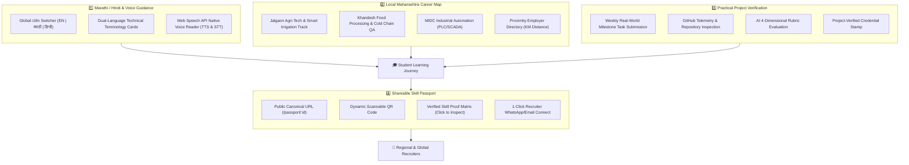

# Maharashtra Regional & Skill Passport Suite Plan (Marathi/Hindi Voice + Local Career Map + Project Verification + Skill Passport)

> **Platform**: CareerPath AI Technologies Inc.  
> **Target Capabilities**:  
> 1. 🗣️ **Marathi & Hindi Multilingual + Voice AI Guidance** (Roadmap, Quiz & Results with Web Speech API audio support)  
> 2. 🗺️ **Local Career Map for Jalgaon & Maharashtra Industrial Corridors** (Agri-Tech, Food Processing, MIDC Manufacturing & nearby company proximity)  
> 3. 🛠️ **Practical Project Verification Beyond MCQs** (Real code repo & live task submission with automated AI rubric grading)  
> 4. 🪪 **Skill Passport with Dynamic Shareable Link & QR Code** (1-click tamper-proof candidate verification for recruiters)  
> **Status**: ⏳ Ready for Execution (Plan #41)  
> **Tracking File**: [`careerpath-ai/plans/maharashtra_regional_and_skill_passport_suite_plan.md`](./maharashtra_regional_and_skill_passport_suite_plan.md)  

---

## 1. Executive Summary & Problem Context

While conventional EdTech platforms offer generic, English-only Silicon Valley curriculum and shallow multiple-choice quizzes, over **75% of engineering and polytechnic students in North Maharashtra (Jalgaon, Dhule, Nandurbar, Nashik) and rural Maharashtra** face three severe barriers:
1. **Language & Comprehension Barrier**: Complex technical jargon in English causes high cognitive friction and dropouts. Students think, process logic, and communicate in Marathi and Hindi.
2. **Geographical & Industry Disconnect**: Students are taught generic cloud or web stacks without realizing that major regional employers right next door in Jalgaon, MIDC Bhusawal, MIDC Chhatrapati Sambhajinagar, and MIDC Nashik (e.g., Jain Irrigation, Supreme Industries, Legrand, auto/pharma giants) are actively seeking automation, agri-tech, food processing, and rural tech specialists.
3. **The "Quiz-Only" Credibility Trap**: Recruiters no longer trust MCQ quiz scores or static 2-page PDF resumes. They demand **tangible proof**: working code repositories, deployed applications, and project evaluations.

### The Solution: 4 Game-Changing Pillars
This plan introduces a localized, high-credibility talent suite tailored to Maharashtra students and regional employers.



---

## 2. Deep Dive: The 4 Core Pillars

### Pillar 1: 🗣️ Marathi/Hindi Localization & Voice Support
* **Target Audience**: Tier-2 / Tier-3 engineering and polytechnic students across Maharashtra.
* **Architecture**:
  1. **Zero-Overhead Lightweight i18n Engine (`client/js/i18n.js`)**:
     - Global navbar switcher: `[ English | मराठी | हिन्दी ]` stored in `localStorage.getItem('cp_lang') || 'en'`.
     - Data-driven dictionary for all key navigation, headings, assessment steps, quiz interfaces, and feedback alerts.
  2. **Dual-Language Concept Cards**:
     - For technical terms that should not be purely translated into awkward words, we provide the English industry term with Marathi/Hindi conceptual explanation:
       > *Event Loop (इव्हेंट लूप)*: जावास्क्रिप्टमधील असिंक्रोनस कार्ये (Asynchronous Tasks) मुख्य थ्रेड ब्लॉक न करता हाताळणारी यंत्रणा.
  3. **Native Voice Guidance (TTS & Speech-to-Text)**:
     - "ऐका / सुनो" (Listen) audio speaker button on every weekly roadmap task, quiz question, and concept summary.
     - Implemented using native browser `window.speechSynthesis` (`mr-IN` / `hi-IN` / `en-IN` voice pitch and rate controls) $\rightarrow$ **0 API cost, zero network latency, 100% offline-compatible**.
     - AI Career Mentor voice microphone input via `SpeechRecognition` / `webkitSpeechRecognition`.

---

### Pillar 2: 🗺️ Local Career Map (Jalgaon & Maharashtra Industrial Clusters)
* **Target Employers & Regions**:
  - **Jalgaon**: Jain Irrigation Systems Ltd (Jain Hills & Jain Valley), Supreme Industries, Orient Cement, local pulse/dal mills, banana export cooperatives.
  - **Bhusawal**: Thermal Power Station, Central Railway Electrical Locomotive Shed & Engineering Works.
  - **Chhatrapati Sambhajinagar (Aurangabad MIDC / Shendra / Waluj)**: Bajaj Auto, Skoda Auto Volkswagen, Lupin, Endurance Technologies, Sterlite.
  - **Nashik MIDC (Ambad / Satpur)**: Mahindra & Mahindra, Bosch, ABB, Crompton Greaves, Schneider Electric.
* **4 New Regional Career Roadmaps (`server/data/regionalCareersData.js`)**:
  1. **Agri-Tech & Smart Irrigation Systems Specialist**:
     - Skills: IoT Sensor Telemetry, Micro-irrigation Controllers, Solar Pump Automation, Soil Moisture Analytics, Embedded C / Arduino, Python.
  2. **Food Processing & Cold Chain QA Engineer**:
     - Skills: Fruit Dehydration & Pulping Tech, HACCP Quality Standards, Supply Chain Cold Storage Monitoring, ISO 22000, Inventory ERP.
  3. **Industrial Automation & PLC/SCADA Maintenance Engineer**:
     - Skills: PLC Programming (Siemens/Allen-Bradley), SCADA / HMI Screen Design, Sensor & Relay Circuits, Industrial Robotics Basics, Predictive Maintenance.
  4. **Rural FinTech & Local MSME Digital Transformation Specialist**:
     - Skills: UPI & Payment Gateway Integration, District Cooperative Banking Software, Tally ERP, B2B Agri-Commerce Portals, Mobile CRM.
* **Proximity Employer Radar (`client/js/local-industry-radar.js`)**:
  - Interactive map/card display calculating distance in kilometers from student's college city (e.g., *Jalgaon $\rightarrow$ Jain Hills: 8 km*, *Jalgaon $\rightarrow$ Bhusawal: 28 km*, *Jalgaon $\rightarrow$ Aurangabad MIDC: 155 km*).
  - Displays verified direct internship and fresher openings for regional companies.

---

### Pillar 3: 🛠️ Practical Project Verification (Beyond MCQs)
* **Problem Solved**: MCQ quizzes can be guessed; code and working deliverables cannot.
* **Workflow**:
  1. **Milestone Project Brief**: Each week's roadmap on `roadmap.html` includes a tangible mini-project challenge (e.g., *Week 2: Build a Responsive Local Farmers Produce Catalog with Filterable Category Cards*).
  2. **Submission Chamber (`#projectSubmissionModal`)**:
     - Accepts:
       - `githubUrl`: Public GitHub repository link.
       - `liveUrl`: Live deployed link (Vercel, Render, GitHub Pages, or Netlify).
       - `description`: 2-3 paragraph summary of architectural decisions and challenges solved.
  3. **Automated AI Project Evaluator (`server/services/projectVerificationService.js`)**:
     - **Telemetry Check**: Fetches repository metadata via GitHub API or raw scrape (validates repository existence, commit history, README clarity, package.json dependencies).
     - **AI Rubric Scoring (Groq Llama 3.3 / Gemini)**: Evaluates the project across 4 core dimensions:
       1. *Functional Completeness (35%)*: Does the project achieve the weekly objective?
       2. *Code Quality & Structure (25%)*: Clean naming, modular components, separation of concerns.
       3. *Documentation & Setup (20%)*: README structure, setup instructions, architecture explanation.
       4. *Error Handling & Robustness (20%)*: Input validation, responsive CSS, edge case handling.
  4. **Verification Stamp & Ledger Stamp**:
     - If score $\ge 70\%$: Task marked completed, stamps `verificationTier: 'project_verified'` in `User.skills` and `Attempt` ledger.
     - The project title, live link, GitHub link, and verification score are automatically embedded into the student's **Skill Passport**.

---

### Pillar 4: 🪪 Skill Passport (Dynamic Shareable Link & QR Code)
* **Format**: Dedicated public portal at `client/passport.html?id=:studentId` (or `/passport/:username`).
* **Instant 1-Click Verification for Recruiters**:
  1. **Header & Verified Identity**:
     - Student photo, verified badge, College/University (e.g. *KBCNMU Jalgaon*), Degree & Branch, Graduation Year.
     - SHA-256 Tamper-Proof Cryptographic Hash linked to `verify.html`.
  2. **0–100% Job Readiness Scorecard**:
     - Live radial chart with breakdowns across Verified Skills (40%), Roadmap Execution (30%), Resume ATS (15%), and Mock Interviews (15%).
  3. **Verified Skills Matrix**:
     - Clickable skill chips tagged with proof level (`🏆 Project Verified`, `✅ Quiz Verified`, `⭐ Proctored`).
     - Clicking a chip opens proof modal: Date verified, score, proctoring integrity score (100%), and the evaluated project link.
  4. **Evaluated Project Showcase**:
     - Cards showing submitted projects with live demo button, GitHub repo link, and AI evaluator remarks.
  5. **Dynamic Scannable QR Code**:
     - Real-time client-side QR generation using `qrcode.min.js`.
     - Can be downloaded as PNG for printing on physical resumes or shared via WhatsApp in 1 click.
  6. **Recruiter Direct Contact Button**:
     - Verified recruiters can click "⚡ Contact Candidate via WhatsApp" or "📄 Download Verified Skill Dossier PDF".

---

## 3. Implementation Blueprint & File Changes

```text
careerpath-ai/
├── client/
│   ├── js/
│   │   ├── i18n.js                  # [NEW] Multilingual dictionary (EN, MR, HI) & voice speech helper
│   │   ├── local-industry-radar.js  # [NEW] Jalgaon & Maharashtra regional employer map & distance radar
│   │   ├── project-verifier.js      # [NEW] Client handler for GitHub & live project submission
│   │   ├── passport.js              # [NEW] Dynamic Skill Passport renderer & QR code generator
│   │   └── qrcode.min.js            # [NEW] Lightweight pure JS QR code generator
│   ├── passport.html                # [NEW] Dedicated public Skill Passport verification page
│   ├── roadmap.html                 # [MODIFY] Add Project Submission modal, Voice Listen buttons, Language toggle
│   ├── assessment.html              # [MODIFY] Add Marathi/Hindi toggle & Audio Question reader
│   └── dashboard.html               # [MODIFY] Add "View & Share Skill Passport" card with QR preview
├── server/
│   ├── data/
│   │   ├── regionalCareersData.js   # [NEW] 4 Jalgaon/Maharashtra regional career definitions
│   │   └── regionalCompaniesData.js # [NEW] 30+ verified regional companies in Jalgaon, Aurangabad, Nashik
│   ├── services/
│   │   ├── projectVerificationService.js # [NEW] GitHub inspection + AI rubric evaluator (Groq/Gemini)
│   │   └── passportService.js       # [NEW] Compiles canonical Skill Passport data with cryptographic hash
│   ├── controllers/
│   │   ├── projectController.js     # [NEW] Endpoints for project submission and evaluation
│   │   └── passportController.js    # [NEW] Public endpoints for Skill Passport data lookup
│   └── routes/
│       ├── projectRoutes.js         # [NEW] POST /api/projects/submit, GET /api/projects/:id
│       └── passportRoutes.js        # [NEW] GET /api/passport/:id
```

---

## 4. Verification Plan (Gravitas Evidence Protocol)

### Automated Test Suite:
```powershell
# 1. Syntax & Integrity Check
node --check server/services/projectVerificationService.js
node --check server/services/passportService.js
node --check server/controllers/projectController.js
node --check server/controllers/passportController.js

# 2. Test Project Verification Evaluation Pipeline
node -e "const { evaluateProject } = require('./server/services/projectVerificationService'); evaluateProject({ githubUrl: 'https://github.com/facebook/react', liveUrl: 'https://react.dev', description: 'React UI library' }).then(console.log);"

# 3. Test Skill Passport Generation
node -e "const { generatePassportData } = require('./server/services/passportService'); console.log('Passport service loaded successfully');"

# 4. End-to-End Server Route Check
node --check server/server.js
```

### Manual Verification:
1. Open `client/roadmap.html` in browser $\rightarrow$ switch language to **मराठी** $\rightarrow$ verify UI text and roadmap task descriptions update cleanly.
2. Click the **"ऐका (Listen)"** audio button $\rightarrow$ verify browser speaks the task objective in clear Indian Marathi voice.
3. Open `client/recommendations.html` $\rightarrow$ filter by "Regional / Local Careers" $\rightarrow$ verify **Agri-Tech & Smart Irrigation** and **MIDC Industrial Automation** appear with nearby employers (Jain Irrigation, Supreme).
4. On `roadmap.html`, open **"Submit Practical Project"** $\rightarrow$ submit a GitHub URL $\rightarrow$ verify AI reviews the repo, outputs rubric scores, and stamps `Project Verified`.
5. Open `client/passport.html?id=<userId>` $\rightarrow$ verify the student's **Skill Passport** renders with QR code, verified skills matrix, and clickable project links.

---

## 5. Master Tracker Status Update

| # | Plan File | Plan Description | Status |
|:---:|---|---|:---:|
| **40** | [`whatsapp_automation_suite_plan.md`](./whatsapp_automation_suite_plan.md) | WhatsApp Suite: Instant OTP + Weekly PDF Delivery + 24x7 AI Chatbot | **✅ Yes** |
| **41** | [`maharashtra_regional_and_skill_passport_suite_plan.md`](./maharashtra_regional_and_skill_passport_suite_plan.md) | Maharashtra Regional & Skill Passport Suite (Marathi/Hindi Voice + Local Map + Project Verification + Skill Passport) | **⏳ Ready for Execution (Current Plan)** |
