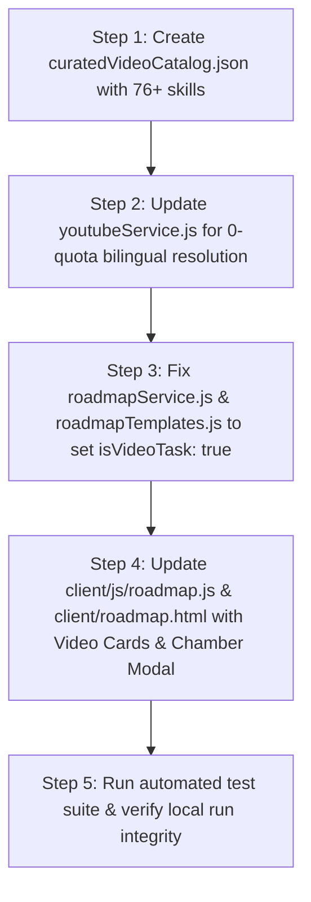

# Plan #43: 100% Video-First Roadmap Transformation for Disheera

> **Strategic Objective**: 
> Transform Disheera from text-heavy documentation links into a **100% Video-First Learning Platform** across all 5 career tracks (Front-End, Back-End, Full-Stack, Data Science, AI/ML) and dynamic roadmaps. 
> Powered by an authoritative **Curated Free Video Catalog (76+ Skills)** with **Bilingual (English + Hindi) Support**, **Zero API Quota Risk**, and the **Focus Video Chamber** with AI Dedication Monitoring.

---

## 1. Goal Description & Current Architecture Problem

### The Core Problem
1. **Student Drop-off from Dense Text**: Roadmaps currently link primarily to 40-page documentation pages (MDN, CSS-Tricks, GitHub topics). Students lose momentum without visual, step-by-step code demonstrations.
2. **Frontend Video Suppression Bug (`client/js/roadmap.js:486–491`)**:
   ```javascript
   // Current code in client/js/roadmap.js:
   let resourceBadge = '';
   if (task.resource?.url && !isVideo) { // ❌ Explicitly hides video tasks!
     resourceBadge = `<a href="${task.resource.url}" ...>${task.resource.type || 'Documentation'}</a>`;
   }
   ```
   Even when tasks had video links, the frontend suppressed them, rendering only documentation badges.
3. **Dynamic Task Generator Suppression (`server/services/roadmapService.js:193–213`)**:
   Dynamic task generation explicitly converts `mediaType = 'doc'`, overrides YouTube URLs with generic MDN search URLs, and sets `isVideoTask: false`.
4. **YouTube API Quota Fragility**: Relying solely on real-time YouTube Data API v3 (`search.list`) causes quota exhaustion (100 units/call, max 10,000 units/day = only 100 requests).

### What This Plan Delivers
- **100% Video-First Experience**: Every milestone task across all 5 career tracks features an interactive video card.
- **Offline Curated Video Catalog (`server/data/curatedVideoCatalog.json`)**: 76+ skills mapped to top-tier free courses (freeCodeCamp, Mosh, Traversy, CS50) + Indian/Hinglish educators (Chai aur Code, CodeWithHarry, Thapa Technical).
- **Zero API Cost & 0ms Latency**: Queries local verified catalog first; falls back to Supabase `YoutubeCache` and then API v3. Never crashes or returns 500 when quota is exhausted.
- **Focus Video Chamber (`client/roadmap.html`)**: In-modal YouTube player with tab blur auto-pause, anti-scrubbing progress enforcement, 50% mid-video concept pulse, and 85% reflection gate.

---

## 2. User Review Required

> [!IMPORTANT]
> **Zero API Key & Quota Exhaustion Guarantee**:
> The system operates 100% autonomously without requiring `YOUTUBE_API_KEY`. The offline catalog at `server/data/curatedVideoCatalog.json` contains verified, 11-character embeddable video IDs for 76+ skills. When an API key is present, it augments the cache; when missing or rate-limited, the system falls back to the curated catalog with 0 errors.

> [!TIP]
> **Bilingual (English + Hindi) Educator Switcher**:
> Every task card and the Focus Video Chamber will allow students to toggle between:
> - **Global English Masterclasses**: *freeCodeCamp.org*, *Programming with Mosh*, *Traversy Media*, *CS50*.
> - **Indian / Hinglish Masterclasses**: *Chai aur Code (Hitesh Choudhary)*, *CodeWithHarry*, *Thapa Technical*.
> The selection is remembered per task and persisted to the backend via `PATCH /api/youtube/tasks/:taskId/switch-video`.

---

## 3. Architecture & Data Flow

```
┌──────────────────────────────────────────────────────────────────────────────────────────────────┐
│                      DISHEERA 100% VIDEO-FIRST ROADMAP ARCHITECTURE                         │
├──────────────────────────────────────────────────────────────────────────────────────────────────┤
│                                                                                                  │
│   1. CURATED DATASET (server/data/curatedVideoCatalog.json)                                      │
│      ├── 76+ Skills (HTML, CSS, JS, React, Node, Python, SQL, Docker, ML, Git, etc.)             │
│      ├── English Masters: freeCodeCamp, Mosh, Traversy, CS50                                     │
│      └── Hindi Masters: Chai aur Code (Hitesh Choudhary), CodeWithHarry, Thapa Technical         │
│                                                                                                  │
│                                      │                                                           │
│                                      ▼                                                           │
│   2. RESOLUTION ENGINE (server/services/youtubeService.js)                                       │
│      ├── Step 1: Check curatedVideoCatalog.json (0ms, 0 quota units) ────► RETURN IMMEDIATELY    │
│      ├── Step 2: Check Supabase YoutubeCache (Prisma ORM)                                        │
│      └── Step 3: Fallback to YouTube Data API v3 (only if key present & not cached)              │
│                                                                                                  │
│                                      │                                                           │
│                                      ▼                                                           │
│   3. TEMPLATES & DYNAMIC ENGINE                                                                  │
│      ├── server/data/roadmapTemplates.js: Upgrade all 5 tracks to isVideoTask: true              │
│      └── server/services/roadmapService.js: Resolve video masterclasses for dynamic tasks       │
│                                                                                                  │
│                                      │                                                           │
│                                      ▼                                                           │
│   4. FRONTEND UI & FOCUS VIDEO CHAMBER (client/roadmap.html + client/js/roadmap.js)              │
│      ├── Task Card: Video Thumbnail + Instructor Chip + Language Switch [EN | HI]                │
│      ├── Primary Action: [▶ Watch in Focus Chamber] button                                       │
│      └── Chamber Modal: 16:9 Iframe + Dedication Monitor + 50% Checkpoint + 85% Reflection Gate  │
│                                                                                                  │
└──────────────────────────────────────────────────────────────────────────────────────────────────┘
```

---

## 4. Proposed Changes

### Component 1: Curated Video Catalog Dataset

#### [NEW] `disheera/server/data/curatedVideoCatalog.json`
Comprehensive verified dataset mapping 76+ technical competencies to embeddable YouTube masterclasses with dual-language tracks:
```json
{
  "skills": {
    "javascript": {
      "name": "JavaScript",
      "category": "language",
      "en": {
        "videoId": "jS4aFq5-91M",
        "title": "JavaScript Programming — Full Course for Beginners",
        "channelTitle": "freeCodeCamp.org",
        "durationSeconds": 27720,
        "durationDisplay": "7h 42m",
        "embedUrl": "https://www.youtube.com/embed/jS4aFq5-91M",
        "watchUrl": "https://www.youtube.com/watch?v=jS4aFq5-91M",
        "thumbnailUrl": "https://i.ytimg.com/vi/jS4aFq5-91M/hqdefault.jpg"
      },
      "hi": {
        "videoId": "VlPiVmYuoqw",
        "title": "JavaScript Chai aur Code Full Series",
        "channelTitle": "Chai aur Code",
        "durationSeconds": 18000,
        "durationDisplay": "5h 00m",
        "embedUrl": "https://www.youtube.com/embed/VlPiVmYuoqw",
        "watchUrl": "https://www.youtube.com/watch?v=VlPiVmYuoqw",
        "thumbnailUrl": "https://i.ytimg.com/vi/VlPiVmYuoqw/hqdefault.jpg"
      },
      "alternatives": [
        {
          "videoId": "W6NZfCO5SIk",
          "title": "JavaScript Tutorial for Beginners: Learn JavaScript in 1 Hour",
          "channelTitle": "Programming with Mosh",
          "language": "en"
        },
        {
          "videoId": "chx9RSx1NTo",
          "title": "JavaScript Tutorial in Hindi",
          "channelTitle": "CodeWithHarry",
          "language": "hi"
        }
      ]
    }
  }
}
```

Skills included in initial catalog:
- **Languages**: JavaScript, TypeScript, Python, Java, C++, C#, Go, Rust, PHP, Ruby, Kotlin, Swift, Dart, R, SQL, Bash.
- **Frontend**: HTML5, CSS3, Flexbox, CSS Grid, Tailwind CSS, Bootstrap, React, Next.js, Vue.js, Angular, Svelte, Redux, Webpack, Vite.
- **Backend**: Node.js, Express.js, NestJS, Django, FastAPI, Flask, Spring Boot, ASP.NET Core, GraphQL, REST APIs, Microservices, WebSockets.
- **Databases**: PostgreSQL, MongoDB, MySQL, Redis, Supabase, Firebase, SQLite, Prisma ORM, Mongoose.
- **Cloud & DevOps**: Git, GitHub, Docker, Kubernetes, AWS, Google Cloud, Azure, CI/CD (GitHub Actions), Linux System Admin, Nginx, Terraform.
- **AI & Data Science**: Machine Learning, Deep Learning, Pandas, NumPy, Scikit-learn, TensorFlow, PyTorch, LangChain, LLMs & Prompt Engineering, Computer Vision, NLP.
- **Cybersecurity & Testing**: Cybersecurity Fundamentals, OWASP Top 10, Jest, Playwright, Ethical Hacking, Web Security.

---

### Component 2: Backend Resolution Engine & Templates Overhaul

#### [MODIFY] `disheera/server/services/youtubeService.js`
1. Load `server/data/curatedVideoCatalog.json` at startup.
2. In `searchYouTubeVideos` and `resolveVideoForTask`:
   - Inspect query/skill key and preferred `language` (`'en'` or `'hi'`).
   - Match against `curatedVideoCatalog.json` first (0ms latency, 0 quota cost).
   - If found, return immediate structured video object with primary instructor + bilingual alternatives.
   - If not found in curated catalog, query Supabase `YoutubeCache` (Prisma).
   - Fall back to YouTube Data API v3 only when API key is present and uncached.
3. Add helper `getCuratedSkillsList()` to expose all 76+ supported skills.

#### [MODIFY] `disheera/server/services/roadmapService.js`
1. Fix fallback task generation (lines 73–110):
   - Replace hardcoded `https://developer.mozilla.org/en-US/search?q=...` with resolved video objects from `youtubeService`.
   - Set `isVideoTask: true` and map real duration, embed URL, thumbnail, and provider.
2. Fix task document normalization (lines 193–220):
   - Delete the logic that forces `mediaType = 'doc'` and overrides YouTube URLs.
   - Retain `isVideoTask: true` for video resources.

#### [MODIFY] `disheera/server/data/roadmapTemplates.js`
1. Update all 5 tracks:
   - `front-end-developer`
   - `back-end-developer`
   - `full-stack-developer`
   - `data-scientist`
   - `ai-ml-engineer`
2. Ensure every week's learning tasks are flagged with `isVideoTask: true`, valid video URLs (`https://www.youtube.com/watch?v=...`), channel names, and estimated video durations.

---

### Component 3: Frontend Interactive Video UI & Focus Video Chamber

#### [MODIFY] `disheera/client/js/roadmap.js`
1. **Fix Task Card Rendering (lines 478–550)**:
   - When a task is a video (`task.isVideoTask || task.resource?.mediaType === 'video'`):
     - Render a rich **Video Lesson Card**:
       - 16:9 thumbnail preview with hover play icon overlay.
       - Badges: `⏱️ Duration` (e.g. `15 mins`), `Channel Name` (e.g. `freeCodeCamp.org` / `Chai aur Code`).
       - Language switcher pills: `[ 🇬🇧 EN | 🇮🇳 HI ]`.
       - Primary CTA: `▶ Enter Focus Chamber` (launches modal).
       - Optional secondary link: `📖 Documentation / Cheatsheet` if docs exist.
2. **Focus Video Chamber Engine (`VideoChamberModal`)**:
   - Initialize YouTube IFrame Player API (`YT.Player`).
   - Anti-cheating & dedication tracking:
     - Detect `window.blur` / tab switch -> Pause video immediately and display overlay: *"Session Paused: Maintain focus on the learning video"*.
     - Anti-scrubbing clamp: If user jumps forward more than `currentTime + 5s`, snap back to `maxWatchedTime`.
     - 50% Watch Time: Pause video and pop up the **Mid-Video Concept Pulse** question (loaded via `/api/roadmaps/tasks/:taskId/video-checkpoint`).
     - 85% Watch Time: Unlock the **AI Reflection Gate** on the side panel.
     - Student writes 2-3 sentences of what they learned -> Submits to `POST /api/roadmaps/tasks/:taskId/verify-video`.
     - On successful AI evaluation: Task automatically checks off, progress bar animates, and modal displays celebratory confetti/stamp.

#### [MODIFY] `disheera/client/roadmap.html`
1. Add markup for `#videoChamberModal`:
   - Fullscreen/theater modal layout with split screen:
     - **Left Pane (70%)**: YouTube player container (`#videoChamberPlayerContainer`), dedication HUD, instructor switch button.
     - **Right Pane (30%)**: Lesson notes, mid-video pulse question card, AI reflection textarea, and completion badge.
   - Dedicated styling in `css/style.css` for video lesson cards, hover states, and dedication HUD.

---

### Component 4: Automated Test Suite

#### [MODIFY] `disheera/server/tests/youtube_chamber_test.js`
1. Test loading and JSON schema validation of `curatedVideoCatalog.json` (ensure 76+ skills present, all video IDs are exactly 11 characters).
2. Test bilingual resolution: verify that querying for `javascript` with `language='hi'` returns Chai aur Code or CodeWithHarry, and with `language='en'` returns freeCodeCamp or Mosh.
3. Test task synthesis in `roadmapService.js` to assert that generated roadmaps have `isVideoTask: true` and valid YouTube watch URLs.
4. Verify end-to-end task video switching via `PATCH /api/youtube/tasks/:taskId/switch-video`.

---

## 5. Verification Plan

### Automated Tests
Run the test suite from the project root:
```powershell
node server/tests/youtube_chamber_test.js
npm test
```
**Expected Outcome**: 100% of video catalog entries valid, zero missing fields, bilingual resolution verified, syntax checks pass with 0 errors.

### Manual Verification
1. Open `http://localhost:5000/roadmap.html`.
2. Observe roadmap tasks: every core technical task displays the video thumbnail, duration badge, instructor name, and language toggle.
3. Click `[ 🇮🇳 HI ]` on a task card: verify instructor changes to Hindi educator (e.g. Chai aur Code).
4. Click `[ ▶ Enter Focus Chamber ]`:
   - Modal opens with embedded YouTube player.
   - Switch tabs or minimize window: player pauses with dedication alert banner.
   - Watch until 50%: mid-video pulse question appears.
   - Complete reflection: task receives verified checkmark and updates overall progress.

---

## 6. Implementation Timeline & Sequence


